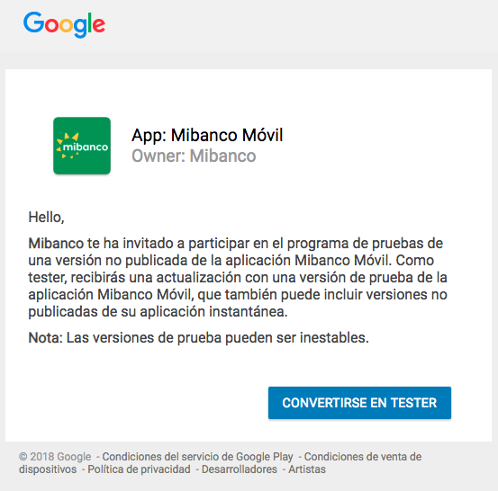
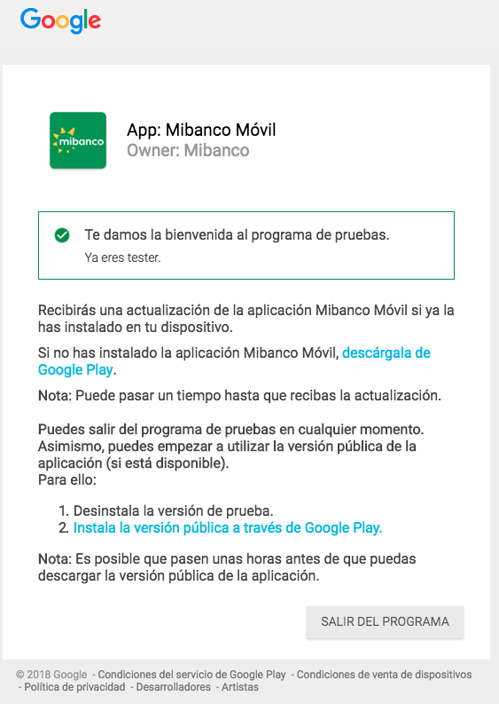
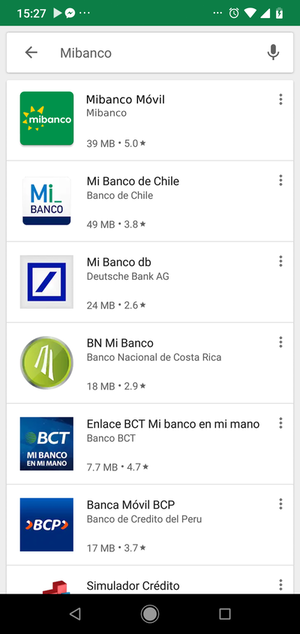
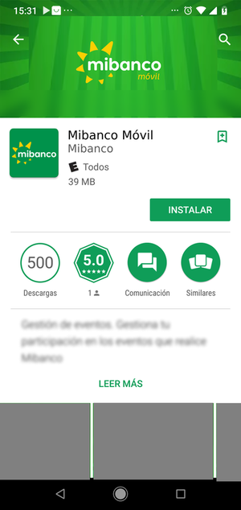
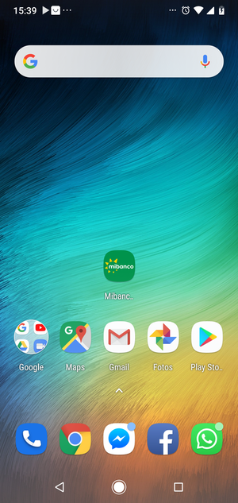

# Mibanco Móvil

# Documento de instalación - Google Play Beta - Android

Instalación de la aplicación de prueba de MiBanco en Android mediante Google Play Beta.

### Email de invitación

La invitación llegará en como un email con un enlace similar a:

- https://play.google.com/apps/testing/com.mibanco.bancamovil

Para poder ver la invitación deberas hacer clic en el enlace.

### Invitación

En el enlace encontrarás la invitación para registrarte como usuario de prueba.

### Aceptación de la invitación

Para aceptar la invitación se deberá hacer clic en el botón "**CONVERTIRSE EN TESTER**".

Luego verás un mensaje confirmando que aceptaste la invitación.

### Instalar la aplicación de prueba

Dentro de Google Play busca "**Mibanco**".

Elige la aplicación que se llame "**Mibanco móvil**".

Presiona el botón "**INSTALAR**" y espera que termine la instalación.

Cuando haya culminado presiona el botón "**ABRIR**".

### Usar la aplicación

Cuando quieras usar la aplicación podras buscarla en tus aplicaciones por el nombre "**Mibanco Móvil**" y abrila presionando sobre el ícono.

