# Mibanco Móvil

# Documento de instalación - TestFlight - iOS

Instalación de la aplicación de prueba de MiBanco en iOS mediante TestFlight.

## Instalación TestFlight

Se requiere que tengas instalado TestFlight en tu dispositivo iOS, para instalarlo primero debes ir al ícono de la aplicación "**App Store**" en tu dispositivo.

 
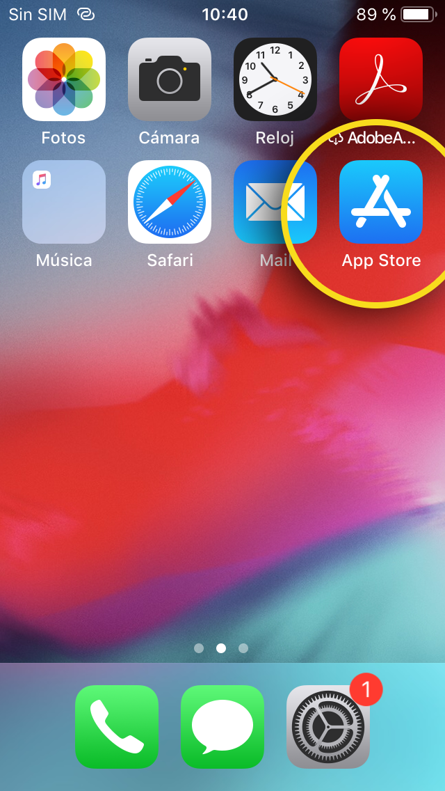
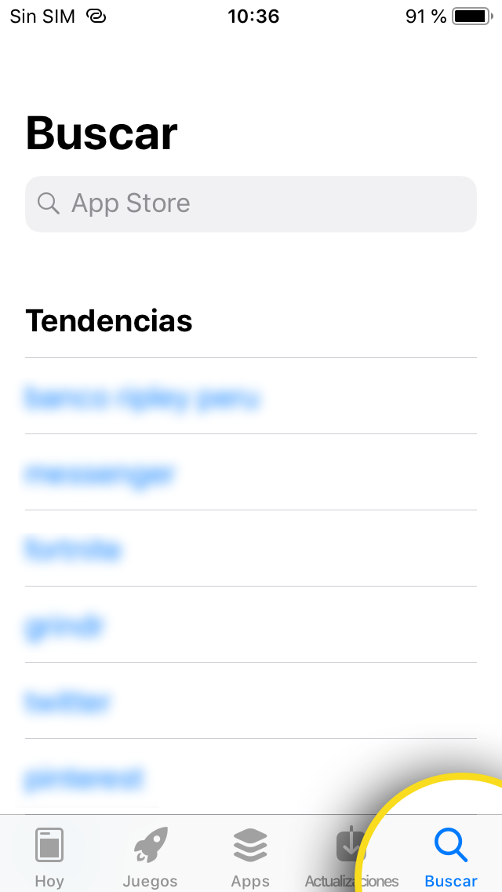

Presionar el botón "**Buscar**" e ingresar "**TestFlight**"

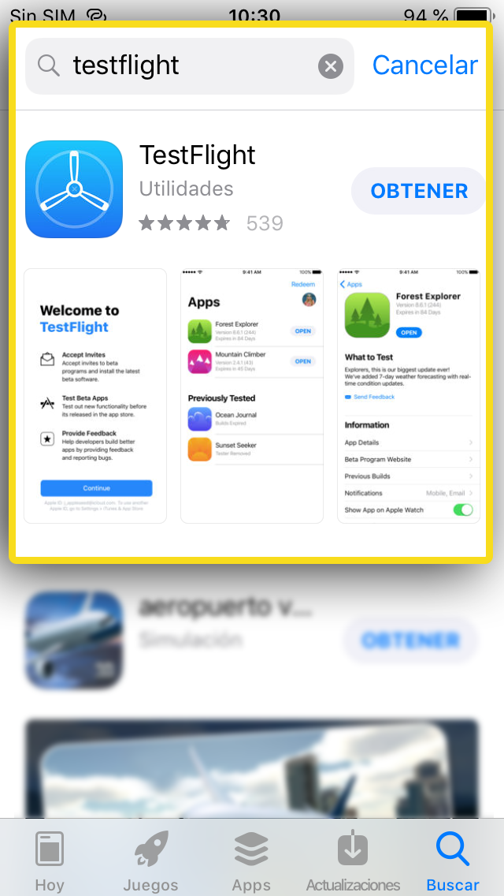

Presionar el botón "**OBTENER**" para instalar la aplicación, cuando termine el proceso de instalación se mostrará un botón "**ABRIR**" junto al ícono de "**TestFlight**" indicando que se instaló la aplicación correctamente.

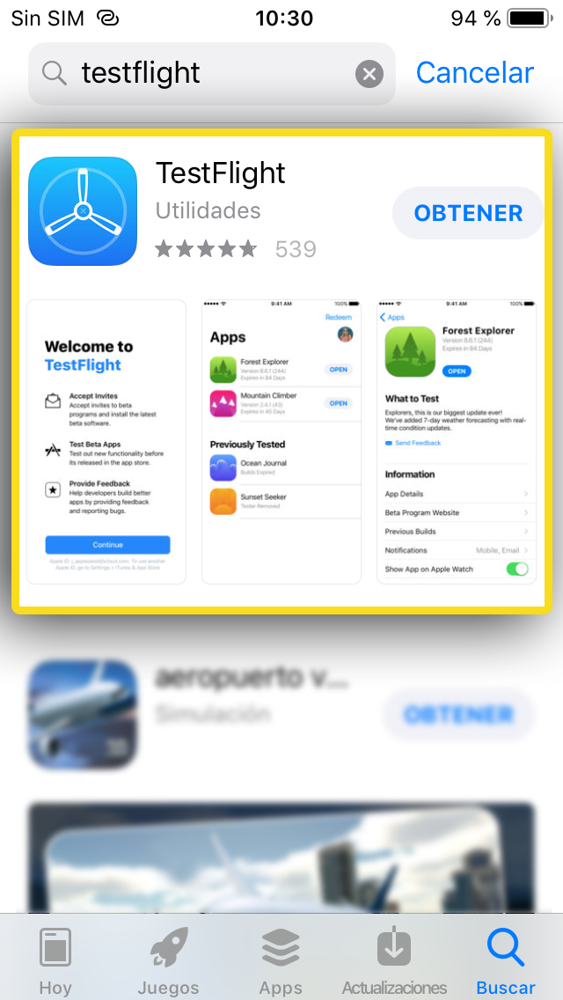
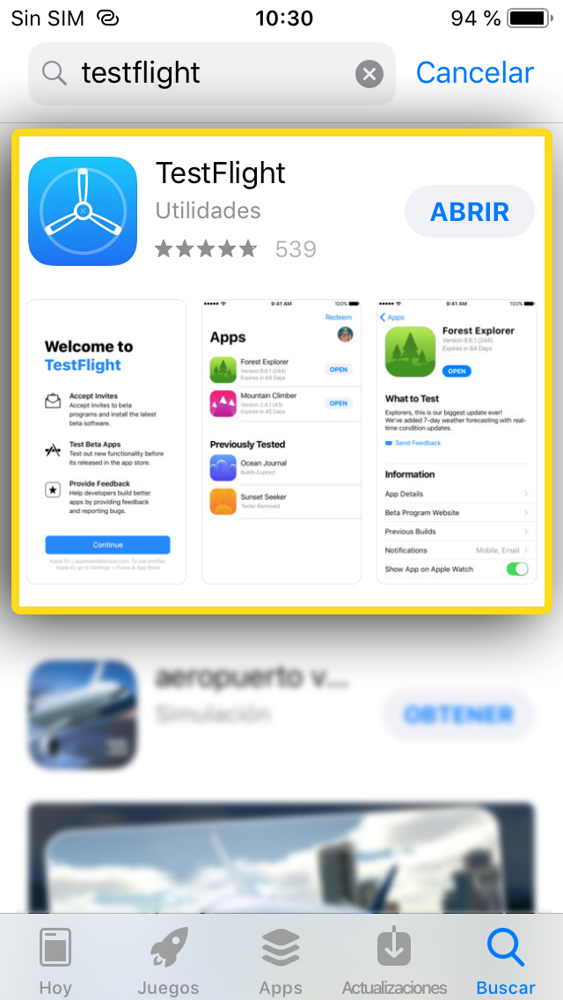

## Invitación de Instalación

Te llegará un email con la invitación. En el mensaje debes presionar en el botón "**View in TestFlight**", se abrirá el navegador y verás un código que se encuentra al final con el siguiente formato: "Enter **CODIGO** and start testing." deberás copiar el código para usarlo mas adelante.

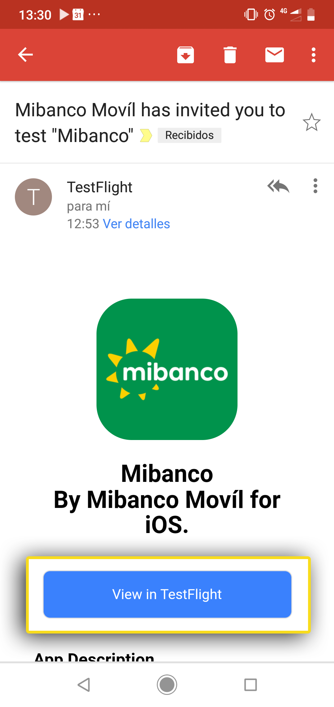
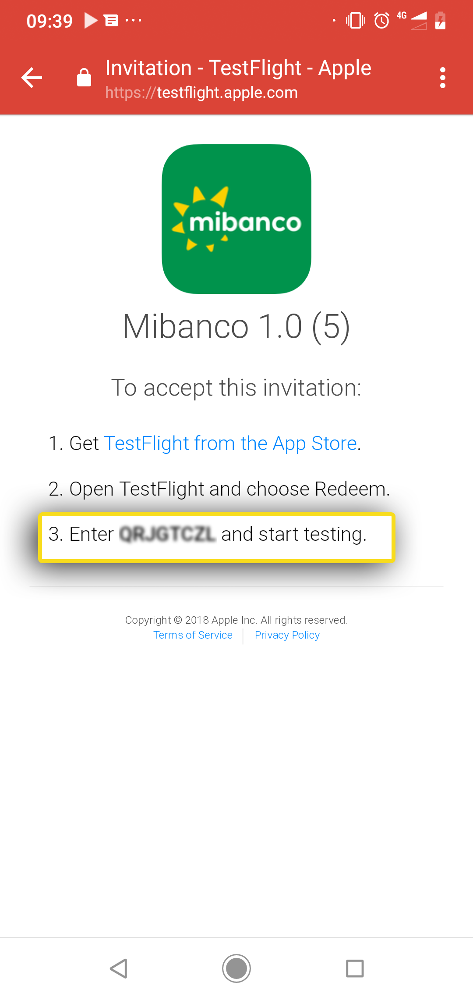

## Instrucciones de TestFlight

Luego del paso anterior, deberás abrir la aplicación "**TestFlight**" y verás un mensaje de bienvenida, para continuar deberás presionar el botón "**Continue**"

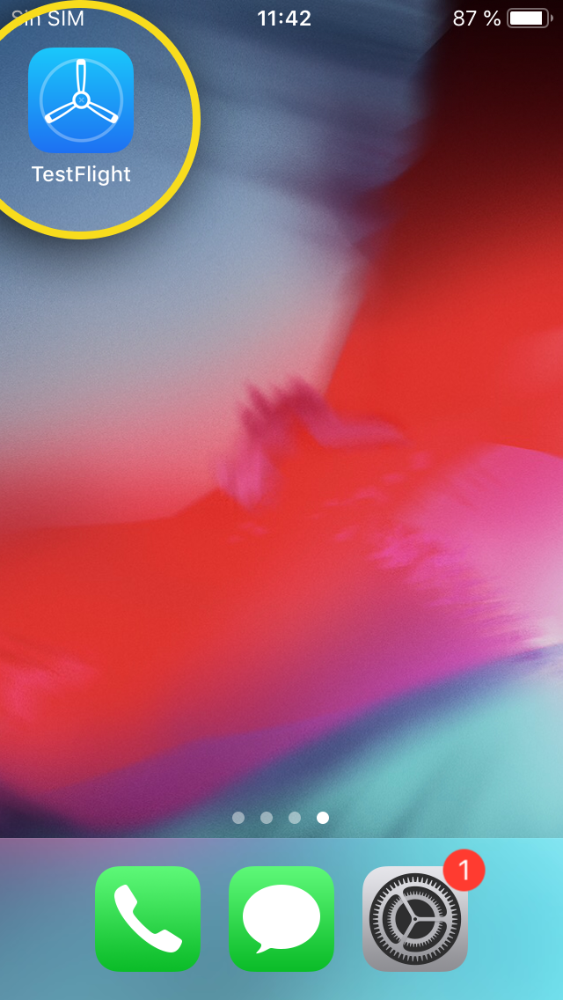
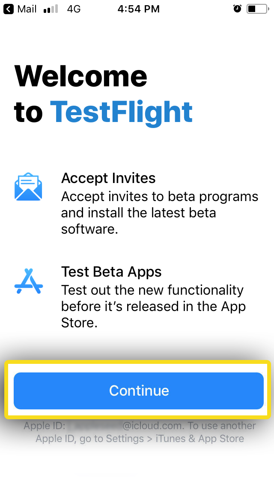

después tendrás que aceptar los términos y condiciones de la aplicación presionando en el botón "**Accept**" y luego aceptar las notificaciones de la aplicación presionando el botón "**Allow**".

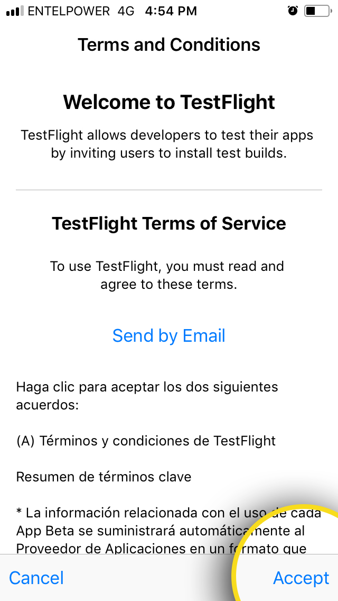
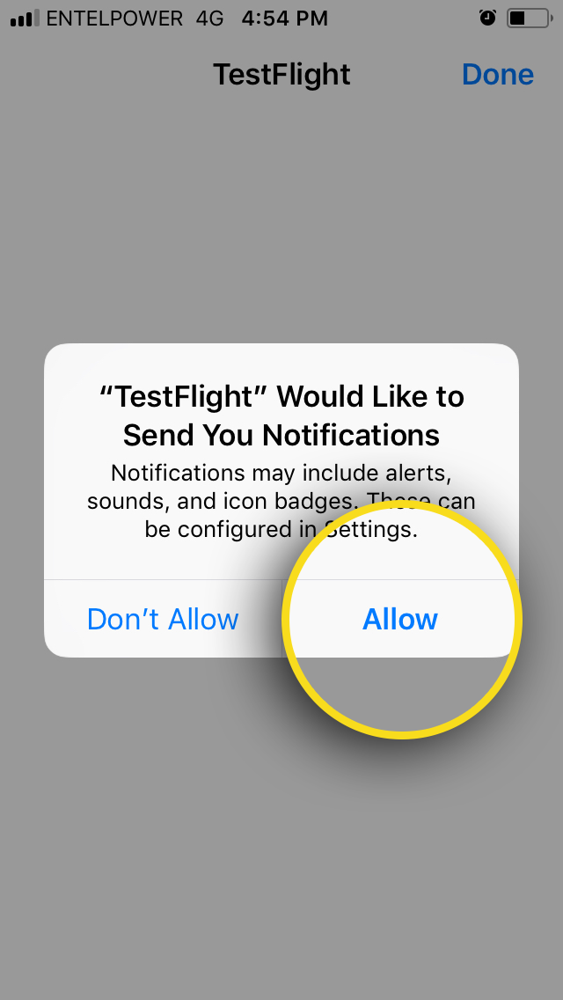

## Ingresar código de invitación

Cuando hayas completado el paso anterior, en la aplicación se mostrará el mensaje "**Welcome to TestFlight**", ahora deberás presionar el botón "**Redeem**" y se te pedirá ingresar el código que anteriormente copiaste de la invitación que recibiste por correo, cuando lo hayas ingresado presionas el botón "**Redeem**".

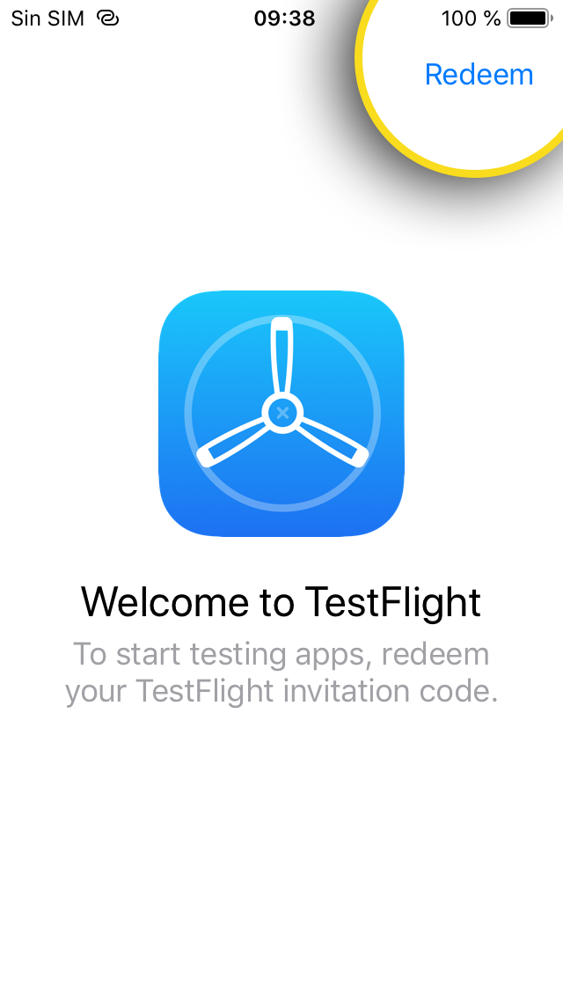
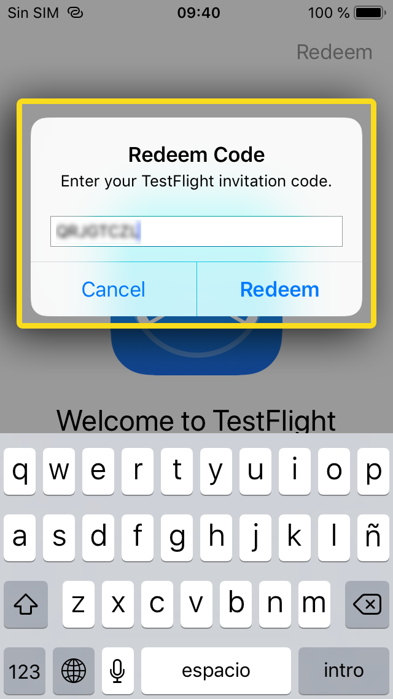

Después verás un mensaje de confirmación indicando que acabas de reclamar el código, para ocultar el mensaje presionas el botón "**OK**" y la aplicación comenzará a instalarse.

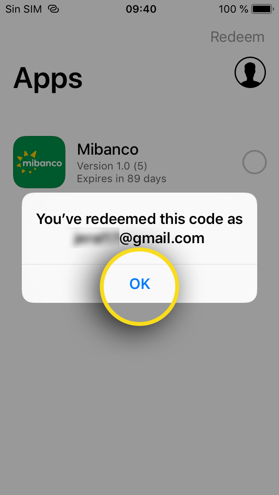
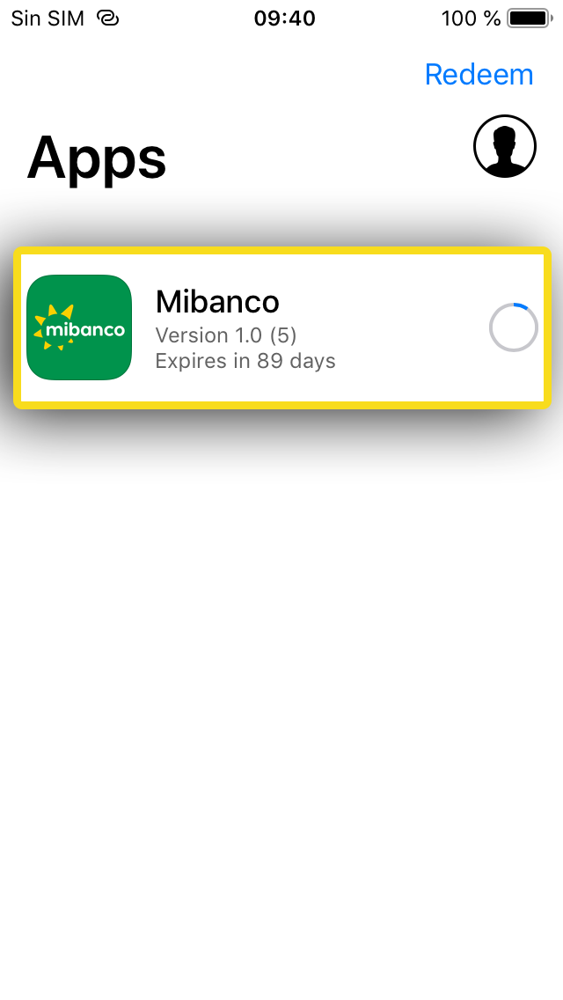

Cuando acabe la instalación deberás presionar el botón "**OPEN**" para poder usar la aplicación, de lo contrario deberás buscar la aplicación "**Mibanco Móvil**" en tu lista de aplicaciones y presionar sobre el ícono para comenzar a disfrutar la aplicación.

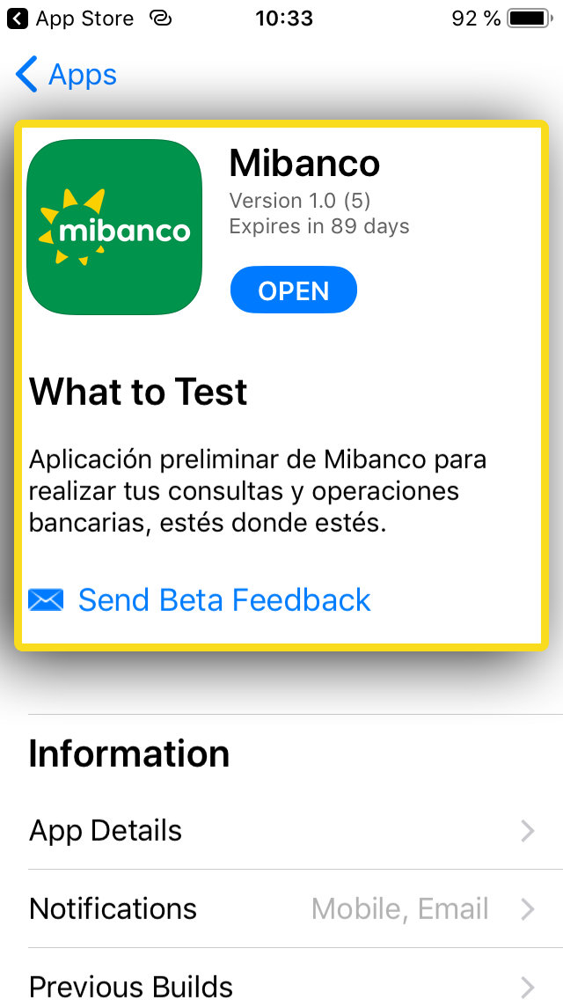
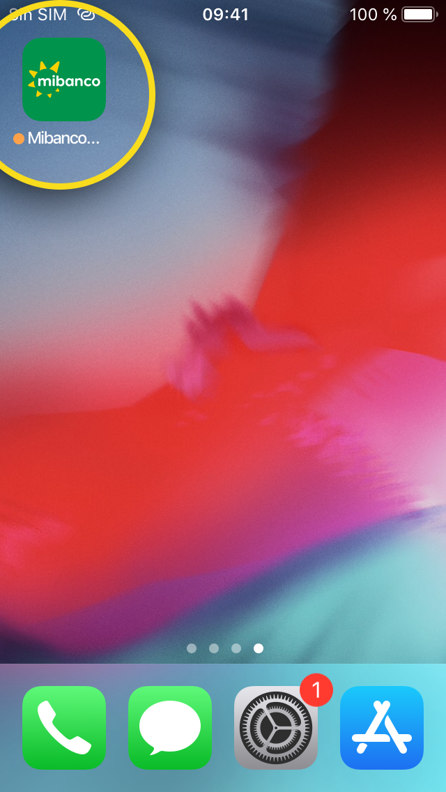

