# Mibanco Móvil

## Documento de Publicación APK - Pase a Producción

Publicación de una aplicación en Play Store (Android).

### Creación de una aplicación

**Se necesita:**

- Cuenta de Google verificada.

**Flujo a seguir:**

Ingresar a la [Google Play Console](https://developer.android.com/distribute/console/) con la cuenta definida y escoger el botón de "Crear una Aplicación", como se muestra en la _Imagen 1_.

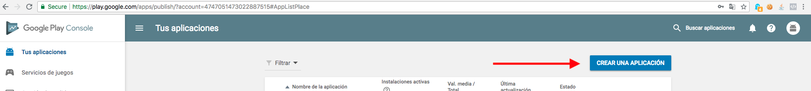

Imagen 1

Para crear una aplicación se debe escoger el lenguaje (se sugiere "Español (Latinoamérica) – es-419") y escribir el nombre con el que va a aparecer la aplicación, como se muestra en la _Imagen 2_.

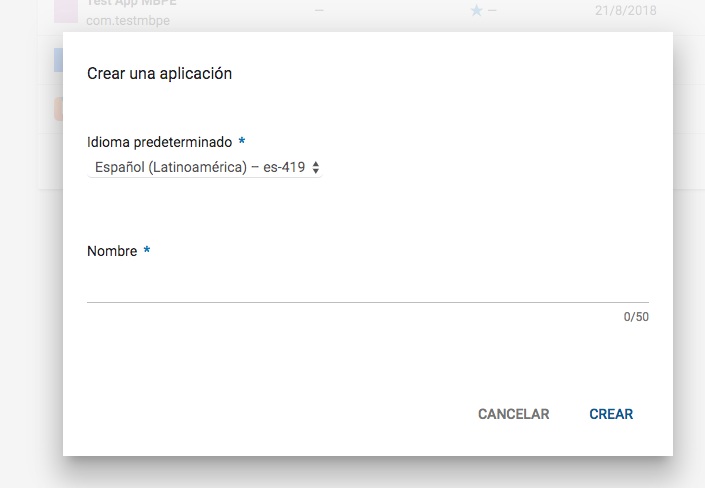

Imagen 2

Luego, se debe rellenar una serie de datos necesarios para la publicación. Mientras la aplicación esté en Alfa o Beta Testing estos datos podrían no ser los finales, sino limitados. Sin embargo, al momento de la publicación final sí deben ser correctamente actualizados. Todos los campos con \* son obligatorios. Los campos a llenar se muestran en las siguientes imágenes.

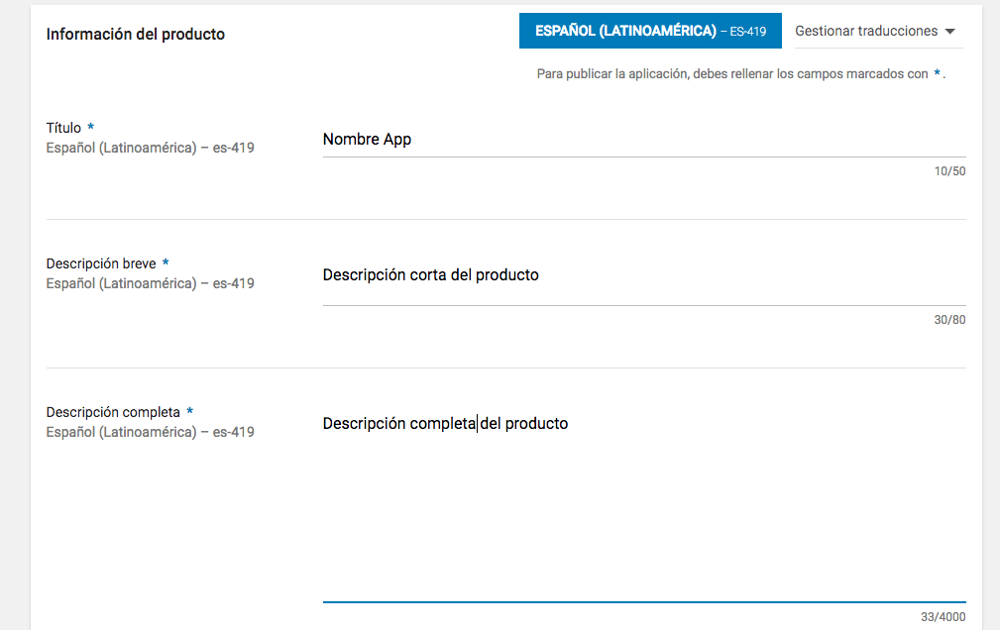

Imagen 3

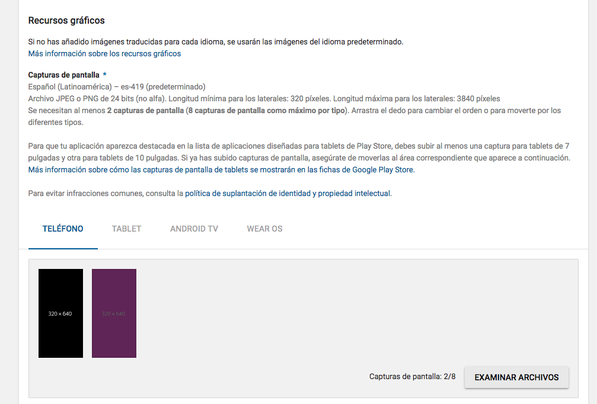

Imagen 4

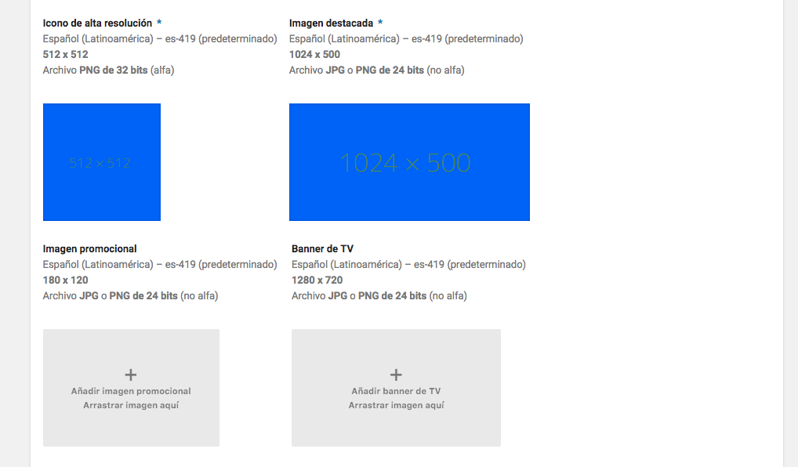

Imagen 5

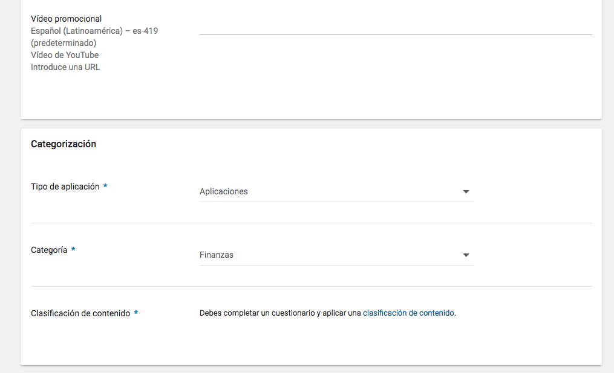

Imagen 6

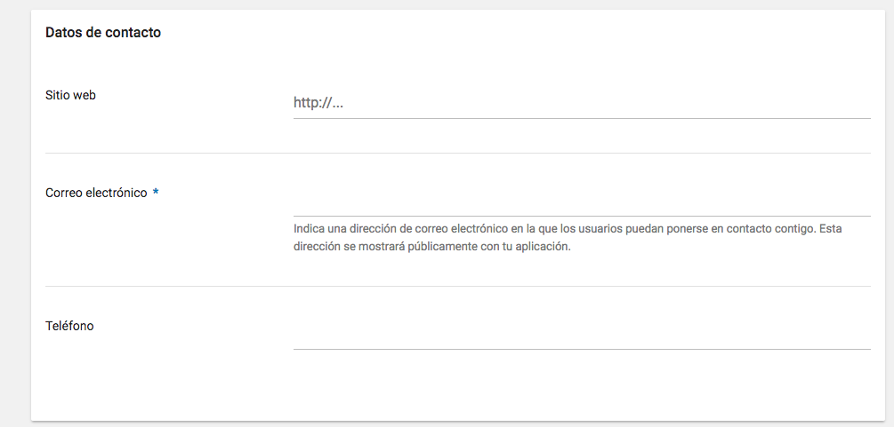

Imagen 7

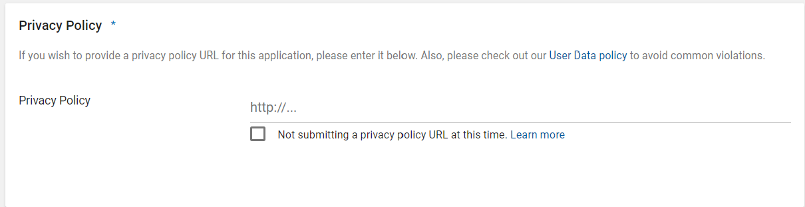

Imagen 8

Al terminar de rellenar todos los datos requeridos, se debe hacer click en el botón azul "Guardar Borrador", como se indica en la _Imagen 9_.

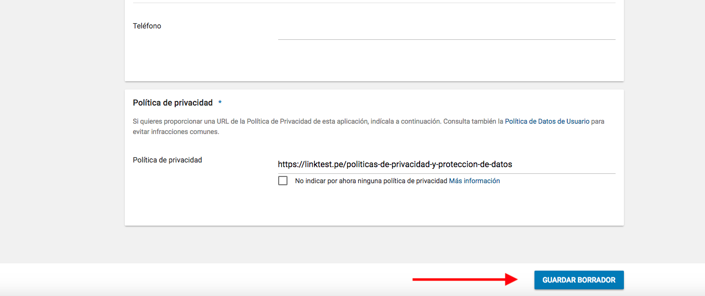

Imagen 9

Cuando haya terminado con el formulario, veremos una barra lateral izquierda como la mostrada en la _Imagen 10_, que nos indica que tenemos pasos por completar para que nuestra App pueda distribuirse: "Versiones de la aplicación", "Clasificación de contenido" y "Precio y distribución". Seguiremos con "Versiones de la aplicación",

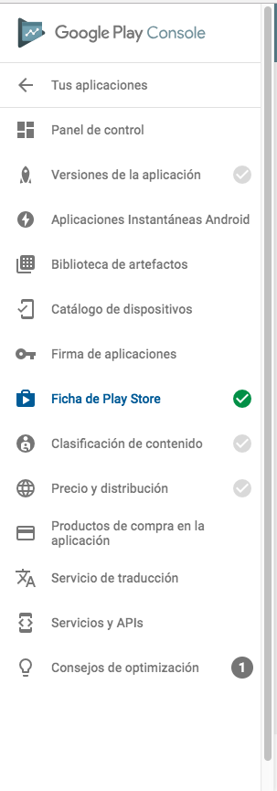

Imagen 10

---

### Despliegue de una aplicación como Alfa y Prueba Interna

Como procedimiento se recomienda empezar primero con una versión "Prueba Interna", el cual permite hasta 100 usuarios y es enfocado en usuarios que estén cercanos al desarrollo.

#### Primer paso: Crear una lista de "testers"

**Crear lista**

- Ingresar a la consola del Play Store.
- En el menú de la izquierda ir a Ajustes -> Administrar testers -> Crear lista.
- Definir un nombre de la lista (por ejemplo "Equipo de desarrollo de canales").
- Luego se agregan los correos de las personas a testear o un archivo CSV con los correos listados uno por línea.
- Presionar el botón de "Crear Lista".

#### Segundo paso: Subir un nuevo .apk "Prueba Interna" o "Alfa"

**Subir nueva versión "Prueba Interna"**

- Ingresar a la consola del Play Store.
- Seleccionar la aplicación.
- En el menú de la izquierda ir a Versiones de la aplicación, si aún no sube ninguna versión, o Gestión de versiones -> Versiones de la aplicación.
- En Segmento de pruebas internas, y al lado de "Prueba Interna", presionar el botón "Nueva Versión", "Editar Versión" o "Administrar" que se muestra en la _Imagen 11_.

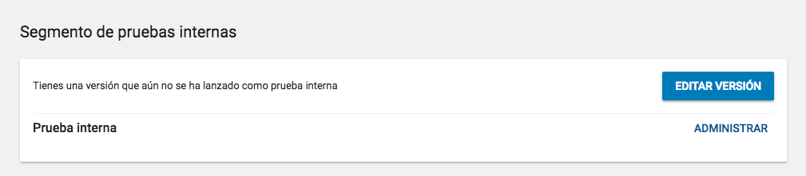

Imagen 11

- Llenar los campos solicitados:
  _ Agregar una nombre de la versión.
  _ Agregar el apk correspondiente.
- Presionar el botón "Revisar".

- Verificar y presionar "Iniciar Lanzamiento a Prueba Interna". En caso de aparecer un mensaje como el de la _Imagen 13_, presionar el flecha y seguir las indicaciones del siguiente paso.

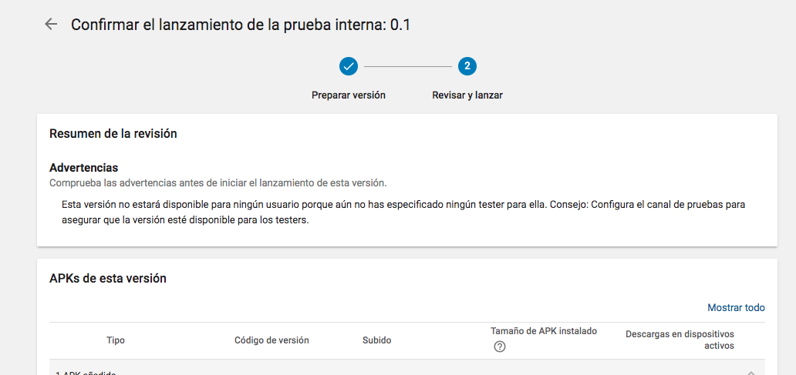

Imagen 13

**Subir nueva versión Alfa**

- Ingresar a la consola del Play Store.
- Seleccionar la aplicación.
- En el menú de la izquierda ir a Versiones de la aplicación, si aún no sube ninguna versión, o Gestión de versiones -> Versiones de la aplicación.
- En Segmento Alfa, y al lado de "Alfa", presionar el botón "Editar Versión Versión" o "Administrar".
- Llenar los campos solicitados:
  _ Agregar una nombre de la versión.
  _ Agregar el apk correspondiente.
- Presionar el botón "Revisar".

- Verificar y presionar "Iniciar Lanzamiento a Alfa". Se debe revisar cada alerta o error y hacer las correcciones correspondientes.

#### Tercer paso: Enlazar la lista creada a la Version subida

**Administrar "testers" a "Prueba Interna"**

- Ingresar a la consola del Play Store.
- Seleccionar la aplicación.
- En el menú de la izquierda ir a "Versiones de la aplicación", si aún no sube ninguna versión, o Gestión de versiones -> Versiones de la aplicación.
- En segmento de Prueba Interna, y al lado de "Prueba Interna", presionar el botón "Administrar".
- Seleccionar el listado de usuarios a utilizar para el segmento.
- Copiar el url "Opt-in URL" para compartir con los usuarios.
- En el campo de "Feedback channel" agregar el email o el url con que se va a recolectar el feedback.

**Administrar "testers" a "Alfa"**

- Ingresar a la consola del Play Store.
- Seleccionar la aplicación.
- En el menú de la izquierda ir a "Versiones de la aplicación", si aún no sube ninguna versión, o Gestión de versiones -> Versiones de la aplicación.
- En Segmento de Alfa, y al lado de "Alfa", presionar el botón "Administrar".
- Seleccionar el listado de usuarios a utilizar para el segmento.
- Copiar el url "Opt-in URL" para compartir con los usuarios.
- En el campo de "Feedback channel" agregar el email o el url con que se va a recolectar el feedback.

---

### Ingresar Precio y Países de distribución

- Ingresar a la consola del Play Store.
- Seleccionar la aplicación.
- En el menú de la izquierda ir a "Precio y Países de distribución".
- Seleccionar si se desea que la aplicación sea de pago o gratuita.
- Seleccionar los países de distribución.
- Completar el formulario, recordando que todos los campos con \* son obligatorios.

---

### Ingresar Clasificación de Contenido

- Ingresar a la consola del Play Store.
- Seleccionar la aplicación.
- En el menú de la izquierda ir a "Clasificación de Contenido".
- Presionar el botón "Seguir".
- Ingresar el correo electrónico y confirmarlo en el formulario que aparece en la _Imagen 14_.

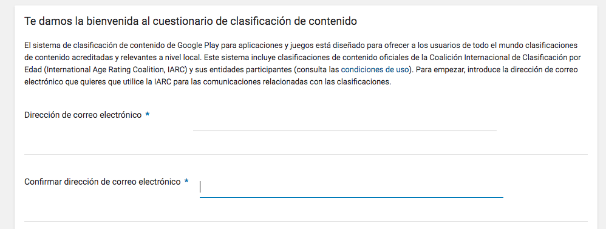

Imagen 14

- Seleccionar la categoría de la aplicación, según las opciones mostradas en la _Imagen 15_.

Imagen 15

- Completar el cuestionario y presionar "Calcular calificación".
- Presionar "Aplicar calificación".

---

### Despliegue de una aplicación como Release

**Agregar a "Producción"**

- Ir a la consola del Play Store.
- En el menú izquierdo escoger Gestión de versiones -> Versiones de la aplicación.
- Para crear un nuevo release, Administrar Segmento de Producción -> Crear Versión.
- Seguir las instrucciones para agregar un APK o app bundles, descripción del release y el nombre.
- Seleccionar "Guardar".
- Seleccionar "Revisar".
- Revisar las políticas de distribución por país.

**Revisar y cargar la "Distribución de Producción"**

- Cuando se selecciona "Revisar", se debe revisar cada alerta o error y hacer las correcciones correspondientes.
- Seleccionar "Confirmar rollout".
