# Mibanco Móvil

## Documento de Publicación IPA - Pase a Producción

Publicación de una aplicación en App Store (iOS).

**Se necesita:**

- Compilado .ipa de la aplicación a testear y publicar
- Cuenta Apple

### Creación de una aplicación en App Store Connect

**Generar una nueva aplicación:**

1. Ingresar a [App Store Connect](https://appstoreconnect.apple.com/) con la cuenta Apple Developer y presionar "Mis Apps".

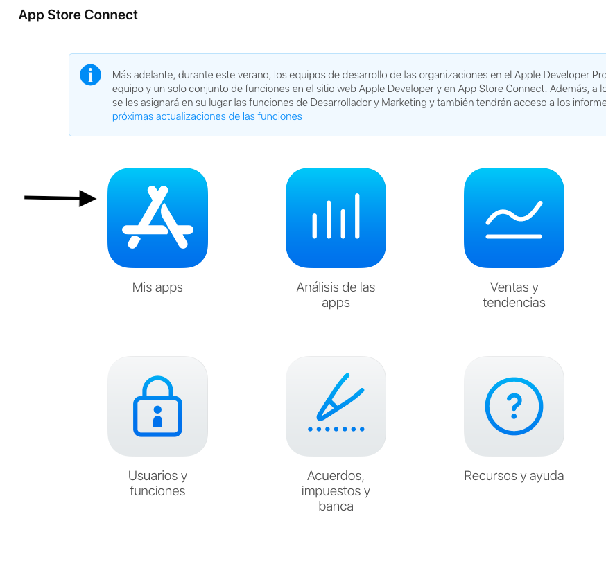

Imagen 1

2. En la esquina superior izquierda, presionar el botón agregar ("+"), como se muestra en la _Imagen 2_.

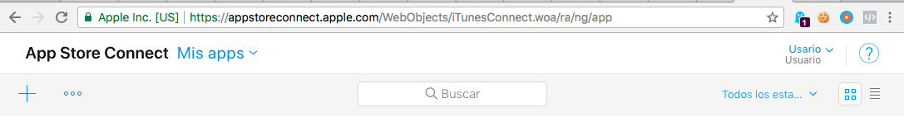

Imagen 2

3. Aparecerá un menú donde deberá ingresar el tipo de App. Escoger "Nueva App".
4. En el pop up que muestra el sitio web, seleccione la plataforma iOS y complete la información del formulario. De necesitar mayor información sobre un campo en específico, puede presionar el botón de ayuda al lado de cada campo.
5. Presionar el botón "Crear".

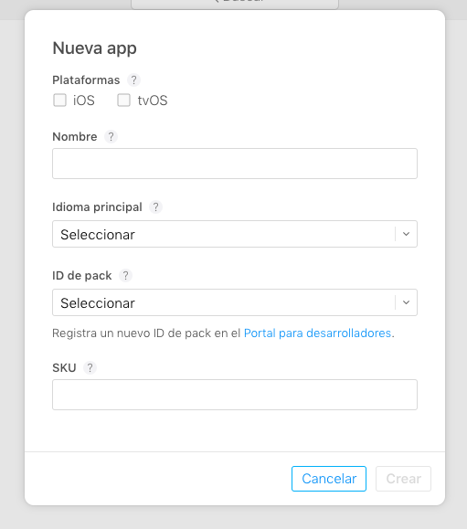

Imagen 3

**Agregar información adicional:**

1. Elegimos la aplicación desde la lista de "Mis Apps" en App Store Connect.
2. En el menú de la izquierda, presionamos "Información de la App".
3. En la vista que aparecerá podemos agregar y modificar valores como el Nombre, Subtítulo, URL de la política de privacidad y la Categoría de la App generada.
4. Al finalizar, en la esquina superior derecha, presionar el botón "Guardar".

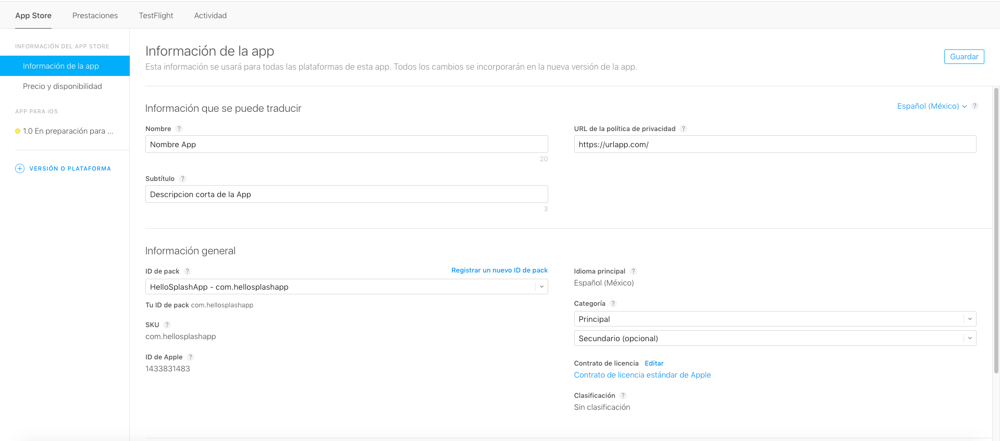

Imagen 4

**Agregar información sobre Precio y disponibilidad:**

1. Elegimos la aplicación desde la lista de "Mis Apps" en App Store Connect.
2. En el menú de la izquierda, presionamos "Precio y disponibilidad".
3. En la vista que aparecerá podemos seleccionar el precio de la aplicación y los países donde estará disponible la aplicación.
4. Al finalizar, en la esquina superior derecha, presionar el botón "Guardar".

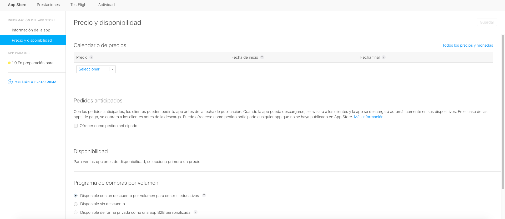

Imagen 5

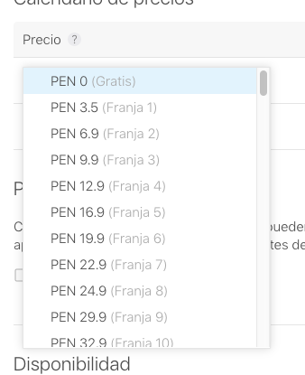

Imagen 6

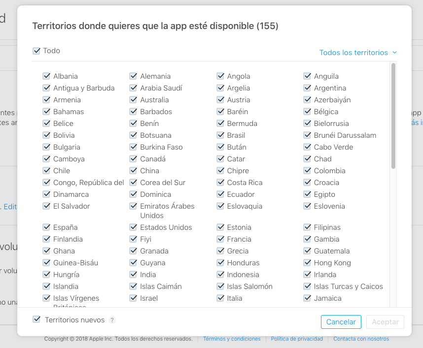

Imagen 7

**Agregar Rating:**

1. Elegimos la aplicación desde la lista de "Mis Apps" en App Store Connect.
2. En el menú de la izquierda, presionamos "1.0 En preparación para el envío".
3. Dentro de la pantalla, buscamos "Información general de la app" y luego "Clasificación".
4. Presionamos Editar, como se muestra en la _Imagen 8_.
5. Aparecerá un pop up con el título "Editar Clasificación" (_Imagen 9_). Completar el formulario y presionar "Aceptar".

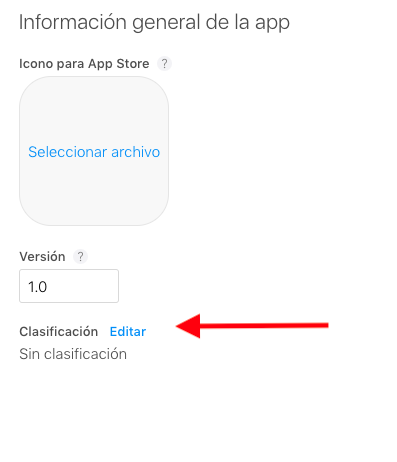

/center>

Imagen 8

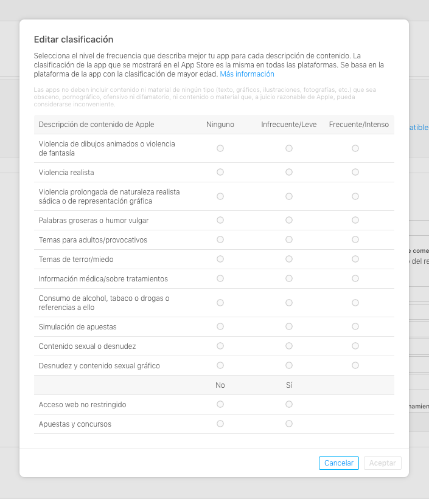

Imagen 9

---

### Cargar .ipa en App Store Connect

- Buscar "Xcode" desde "App Store", en la MacBook donde se realizará el procedimiento, y presionar "Get"/"Install"/"Obtener"/"Instalar" (_Imagen 10_).

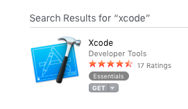

Imagen 10

- Abrir Xcode y en el menú "Xcode" ir a "Open Developer Tool" -> "Application Loader", como se indica en la _Imagen 11_.

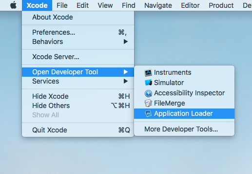

Imagen 11

- Ingresar con la cuenta Apple Developer.
- Aparecerá una pantalla similar a la _Imagen 12_, en la cual debe presionar "Choose" y escoger el archivo .ipa a subir.

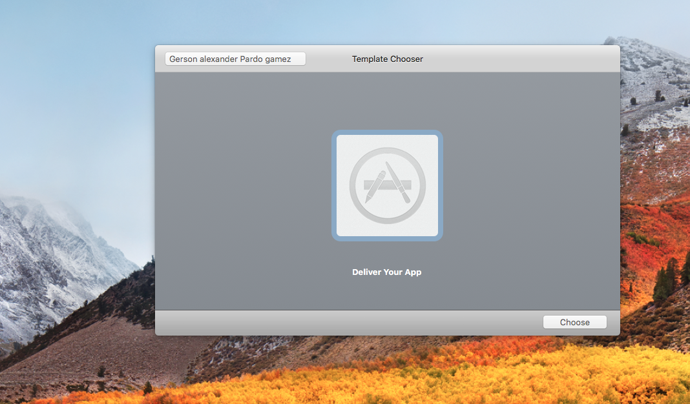

Imagen 12

- Luego aparecerá una pantalla como en la _Imagen 13_, donde podemos confirmar los datos del archivo .ipa escogido. Si todo es correcto, debe presionar "Next".

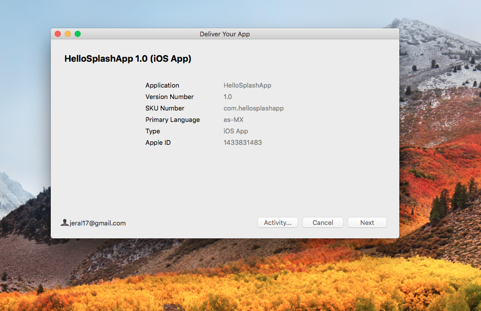

Imagen 13

- Esperamos a que la App termine de ser subida por Application Loader.

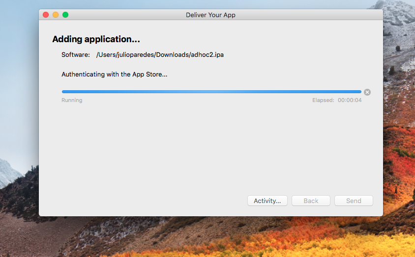

Imagen 14

- Para finalizar, presionamos "Done" y el archivo .ipa estará disponible para el siguiente paso.

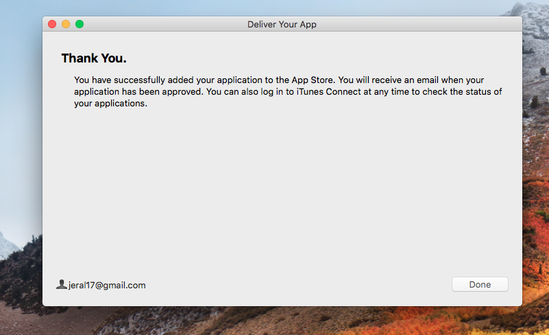

Imagen 15

---

### Enviar la aplicación a Revisión de Apple

1. Elegimos la aplicación desde la lista de "Mis Apps" en App Store Connect.
2. En el menú de la izquierda, presionamos "1.0 En preparación para el envío".
3. Completar toda la información requerida para la versión como capturas de pantalla, texto promocional, palabras clave, descripción y URLs. De necesitar mayor información sobre un campo en específico, puede presionar el botón de ayuda al lado de cada campo.
4. Adjuntar compilación presionando el texto "Antes de enviar tu app, selecciona una compilación" y seleccionando la más reciente de la lista.
5. Ingresar la información general de la app.
6. Para que el equipo de Apple revise la app, se requiere ingresar información para el equipo de revisión de apps. Si la app contiene un login, el equipo de Apple requerirá un usuario y contraseña de prueba con el que ingresar a la aplicación para realizar las validaciones correspondientes. Esta cuenta debe tener datos básicos que permitan validar, como mínimo, las capturas subidas en el paso 3.
7. Dentro de "Publicación de la versión" se debe escoger la opción que corresponda con el tipo de lanzamiento:
   - Publicación Manual (recomendada)
   - Publicación Automática
   - Publicación en una fecha específica
8. Presionar "Guardar", en la esquina superior derecha. Se debe revisar cada alerta o error y hacer las correcciones correspondientes.
9. Presionar "Enviar para su revision", en la esquina superior derecha.

---

### Desplegar la aplicación para Pruebas Internas

#### Agregar usuarios externos para pruebas de TestFlight:

1. Elegimos la aplicación desde la lista de "Mis Apps" en App Store Connect.
2. En el menú superior, presionar "TestFlight" (_Imagen 16_).
3. En el menú lateral izquierdo, presionar "Añadir Probadores Externos"/"Nuevo Grupo (+)" (_Imagen 17_).
4. En el popup, ingresar el nombre del grupo de pruebas a crear.
5. Escoger una de las opciones para el ingreso de usuarios:
   - Agregar usuarios nuevos.
   - agregar usuarios existentes (que ya existan en otro grupo de pruebas).
   - Importar desde un archivo CSV.
6. Se mostrará un aviso como el de la _Imagen 18_, presionar Aceptar.

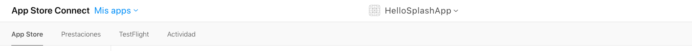

Imagen 16

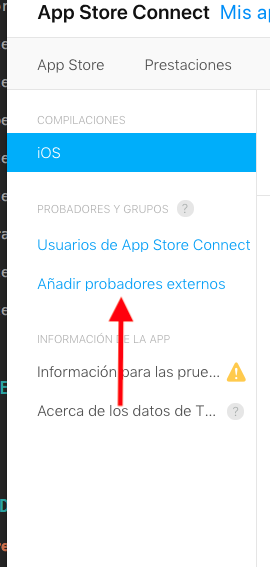

Imagen 17

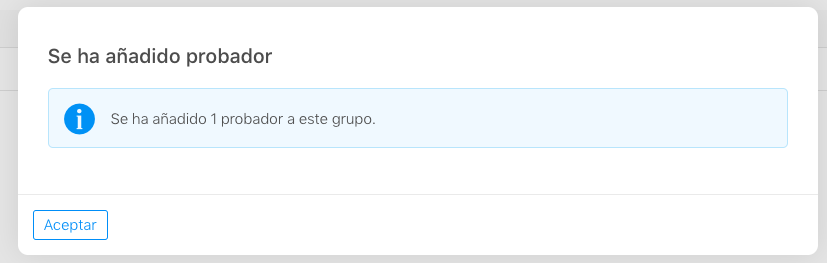

Imagen 18

**En caso de querer retirar usuarios de un grupo de prueba:**

1. Elegimos la aplicación desde la lista de "Mis Apps" en App Store Connect.
2. En el menú superior, presionar "TestFlight".
3. En el menú lateral izquierdo, presionar el nombre del grupo a modificar.
4. En la lista de usuarios, poner el cursor encima del usuario a retirar y presionar el botón "(-)" rojo (_Imagen 19_).

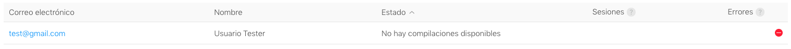

Imagen 19

**En caso de ya tener el grupo creado y querer asignar usuarios:**

1. Elegimos la aplicación desde la lista de "Mis Apps" en App Store Connect.
2. En el menú superior, presionar "TestFlight".
3. En el menú lateral izquierdo, presionar el nombre del grupo a modificar.
4. Presionar "Probadores (+)", el cual se muestra en la _Imagen 20_ como en la _Imagen 21_.

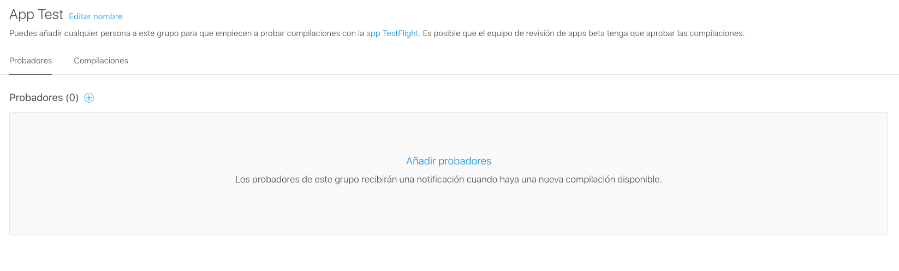

Imagen 20

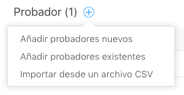

Imagen 21

#### Enviar una versión de la aplicación a grupos de TestFlight:

1. Elegimos la aplicación desde la lista de "Mis Apps" en App Store Connect.
2. En el menú superior, presionar "TestFlight".
3. En el menú lateral izquierdo, presionar sobre "iOS".
4. En el listado de versiones, presionar sobre el número de compilación (_Imagen 22_).
5. Dentro de la pestaña "Probadores", presionar sobre "Grupo (+)" (_Imagen 23_).
6. Aparecerá un pop up como el de la (_Imagen 24_), seleccionar el grupo que se haya creado en la sección anterior y presionar "Siguiente".
7. Completar el formulario del pop up "Información para las pruebas" (_Imagen 25_).

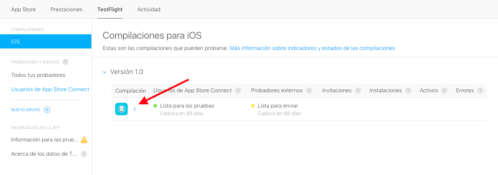

Imagen 22

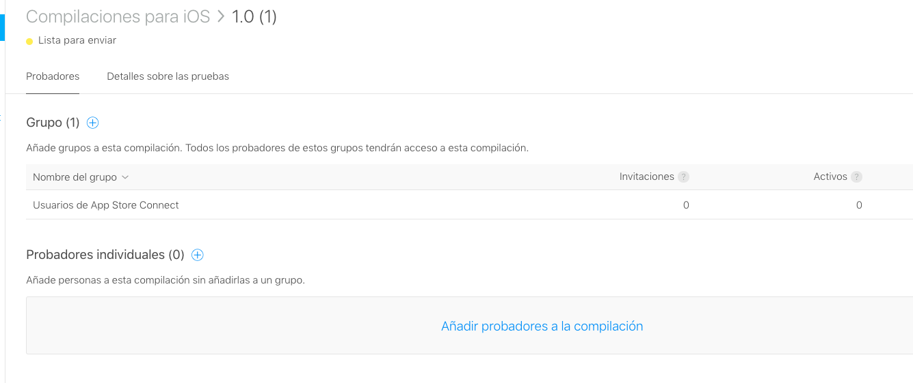

Imagen 23

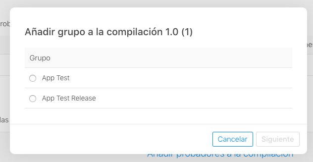

Imagen 24

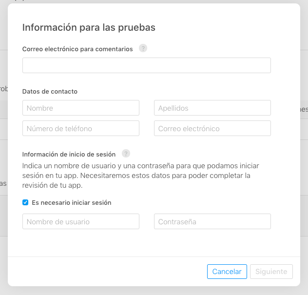

Imagen 25

---

### Desplegar la aplicación para Producción

En caso de haber escogido una Publicación manual en "Enviar la aplicación a Revisión de Apple", debemos realizar este paso. Si, en cambio, escogió una publicación automática o en una fecha específica, este paso no es necesario.

1. Elegimos la aplicación desde la lista de "Mis Apps" en App Store Connect.
2. En el menú de la izquierda, presionamos sobre la versión que tenga por estado "Pending Developer Release".
3. Presionar "Make App Available", en la esquina superior derecha.

---

### Crear una nueva versión de la Aplicación

Cuando se esté listo para distribuir una nueva versión de la aplicación, se debe crear una nueva versión dentro de la plataforma App Store Connect que utilizará como base lo registrado para la versión actual.

Solo se puede crear una nueva versión en la plataforma si el estado de la versión actual es "Listo para la Venta". No se puede, en cambio, si el estado de la versión actual es "En preparación para el envío" o "Esperando revisión".

1. Elegimos la aplicación desde la lista de "Mis Apps" en App Store Connect.
2. En el menú de la izquierda, presionamos "(+) Versión o Plataforma", y seleccionamos "iOS" del menú emergente.
3. En el pop up de "Nueva Versión", ingresar la nuevo versión que aparecerá en el App Store y presionar "Crear".
4. Completar y modificar el formulario de ser necesario. De necesitar mayor información sobre un campo en específico, puede presionar el botón de ayuda al lado de cada campo.
5. Presionar "Guardar", en la esquina superior derecha. Se debe revisar cada alerta o error y hacer las correcciones correspondientes.
6. Presionar "Enviar para su revision", en la esquina superior derecha.
